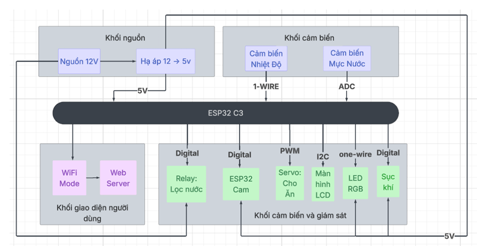
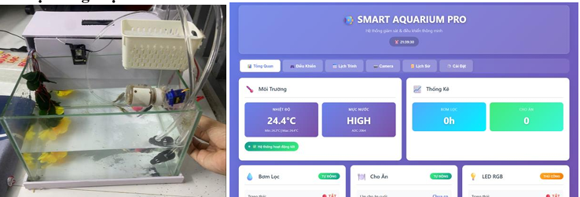
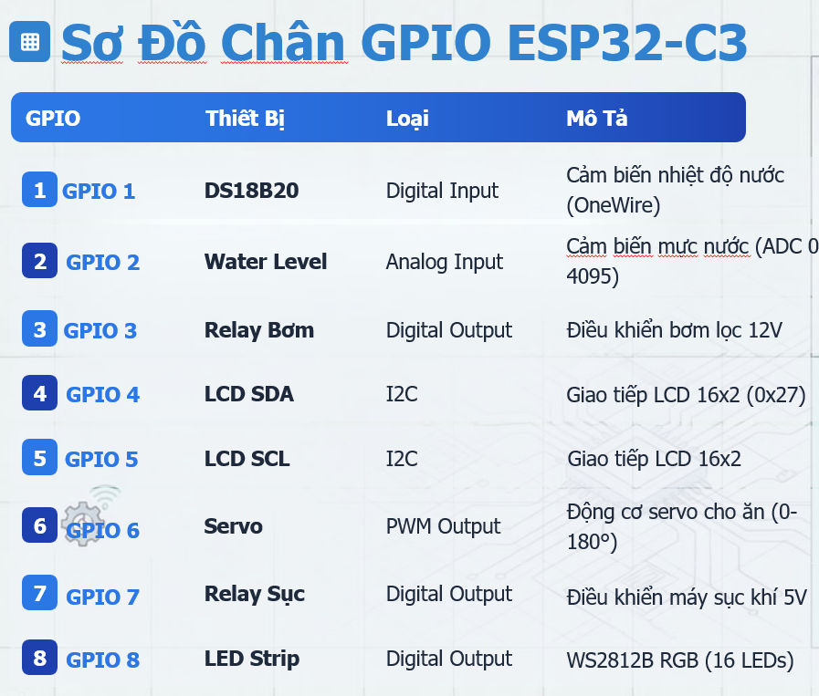

# Smart Aquarium

An ESP32-based smart aquarium prototype designed to monitor water conditions, control aquarium equipment, automate fish feeding, and provide camera streaming through a web interface.

## Features

- **Water Temperature Monitoring:** Measures water temperature using a DS18B20 sensor.
- **Water Level Monitoring:** Reads water-level data from an analog sensor.
- **Automatic Pump Control:** Controls the filter pump through a relay.
- **Aerator Control:** Controls the aquarium aerator through a relay.
- **Automatic Fish Feeding:** Uses a servo motor to operate the feeding mechanism.
- **RGB Lighting:** Uses a WS2812B LED strip for aquarium status lighting.
- **Camera Streaming:** Uses an ESP32-CAM to provide a live camera stream.
- **Web Dashboard:** Provides a web interface for monitoring and system interaction.
- **LCD Display:** Displays local system information through an I²C LCD.

## System Architecture

The system consists of two ESP32-based devices:

- **ESP32-C3 Controller:** Handles sensor readings, aquarium equipment control, feeding operations, RGB lighting, and LCD output.
- **ESP32-CAM:** Handles camera capture and live streaming.

The system uses Wi-Fi for network communication where supported by the firmware.

## Hardware Components

| Component | Function |
|---|---|
| ESP32-C3 | Main system controller |
| ESP32-CAM | Camera capture and live streaming |
| DS18B20 | Water temperature measurement |
| Analog water-level sensor | Water-level monitoring |
| Relay module | Filter pump control |
| Relay module | Aerator control |
| Servo motor | Automatic fish feeding |
| WS2812B RGB LED strip (16 LEDs) | RGB status lighting |
| I²C LCD | Local information display |
| 12 V power supply | Main power source |
| 5 V buck converter | Power conversion |

Check the voltage and current requirements of each component before connecting the hardware. Follow the system schematic for power distribution and grounding.

## GPIO Mapping

The following pin assignments are based on the project's wiring diagram.

### ESP32-C3 Controller

| ESP32-C3 Pin | Component | Function |
|---|---|---|
| GPIO1 | DS18B20 | OneWire data |
| GPIO2 | Water-level sensor | Analog input (ADC) |
| GPIO3 | Pump relay | Digital output |
| GPIO4 | I²C LCD | SDA |
| GPIO5 | I²C LCD | SCL |
| GPIO6 | Servo motor | Servo control |
| GPIO7 | Aerator relay | Digital output |
| GPIO8 | WS2812B RGB LED strip | LED data |

### ESP32-CAM

The camera firmware is located at `firmware/camera/espcam.ino` and contains the camera GPIO definitions.

Verify that the selected ESP32-CAM board matches the pin mapping in the firmware before uploading.

## Repository Structure

```text
smartaquarium/
├── firmware/
│   ├── camera/
│   │   └── espcam.ino
│   └── controller/
│       └── esp32c3.ino
├── images/
│   ├── gpio-mapping.png
│   ├── hardware-demo.png
│   └── system-architecture.png
└── README.md
```

## Getting Started

### Requirements

- Arduino IDE or a compatible Arduino development environment.
- ESP32 board support package.
- ESP32-C3 and ESP32-CAM development boards.
- Required Arduino libraries used by the firmware.
- USB cables and the appropriate programming interfaces.
- The hardware components listed above.

### 1. Clone the Repository

```bash
git clone https://github.com/duypear/smartaquarium.git
cd smartaquarium
```

### 2. Configure Wi-Fi

Open the relevant firmware file and configure the Wi-Fi credentials for your local network.

- ESP32-C3 firmware: `firmware/controller/esp32c3.ino`
- ESP32-CAM firmware: `firmware/camera/espcam.ino`

**Security note:** Do not publish real Wi-Fi passwords, API keys, or other secrets in a public repository. Use a local configuration file excluded from Git or another suitable method to keep credentials private.

### 3. Upload the ESP32-C3 Firmware

1. Open `firmware/controller/esp32c3.ino` in the Arduino IDE.
2. Select the correct ESP32-C3 board.
3. Select the appropriate serial port.
4. Install any required libraries.
5. Upload the firmware.

### 4. Upload the ESP32-CAM Firmware

1. Open `firmware/camera/espcam.ino` in the Arduino IDE.
2. Select the correct ESP32-CAM board configuration.
3. Verify the camera pin mapping and programming connection.
4. Upload the firmware.
5. Open Serial Monitor to check the connection status and any IP address printed by the firmware.

Once connected to Wi-Fi, access the camera stream using the address provided by the firmware, if supported.

## Images

### System Architecture



### Hardware Prototype and Web Dashboard



### GPIO Mapping



## Demo Video

Watch the Smart Aquarium project demonstration:

[](https://youtu.be/gE8q0TRbT-s)

[Watch the full demo on YouTube](https://youtu.be/gE8q0TRbT-s)

## Project Status

This project is a smart aquarium prototype integrating embedded control, sensor monitoring, automatic equipment operation, fish feeding, and camera streaming.

The system should be tested on the actual hardware to verify sensor accuracy, control behavior, network connectivity, and reliability.

## Safety Notes

- Keep electrical connections protected from aquarium water.
- Use suitable enclosures and electrical isolation for relay-controlled equipment.
- Verify the voltage and current ratings of all connected components.
- Secure and waterproof sensors and cables where necessary.
- Do not rely on this prototype as the only protection against aquarium equipment failure.

## License

No license has been specified for this repository yet. Add a license file if you intend to permit others to use, modify, or redistribute the project.